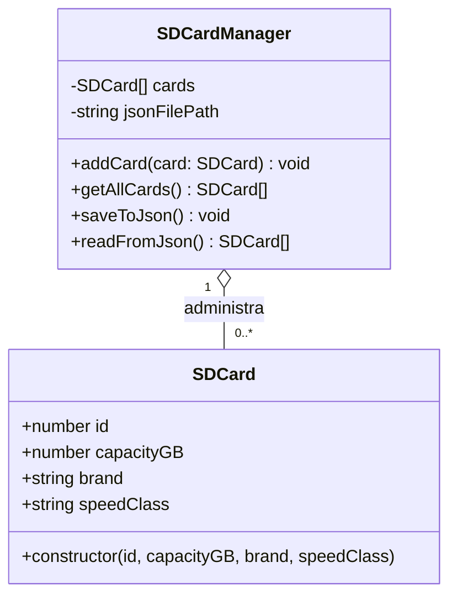

# Diagrama de clases – SD Card

## Descripción
- **SDCard:** modelo de una tarjeta SD. `id` es obligatorio; `capacityGB`, `brand` y `speedClass` son los tres atributos adicionales.
- **SDCardManager:** mantiene la colección dinámica `SDCard[]`, evita IDs duplicados y escribe/lee los objetos en el archivo JSON.
